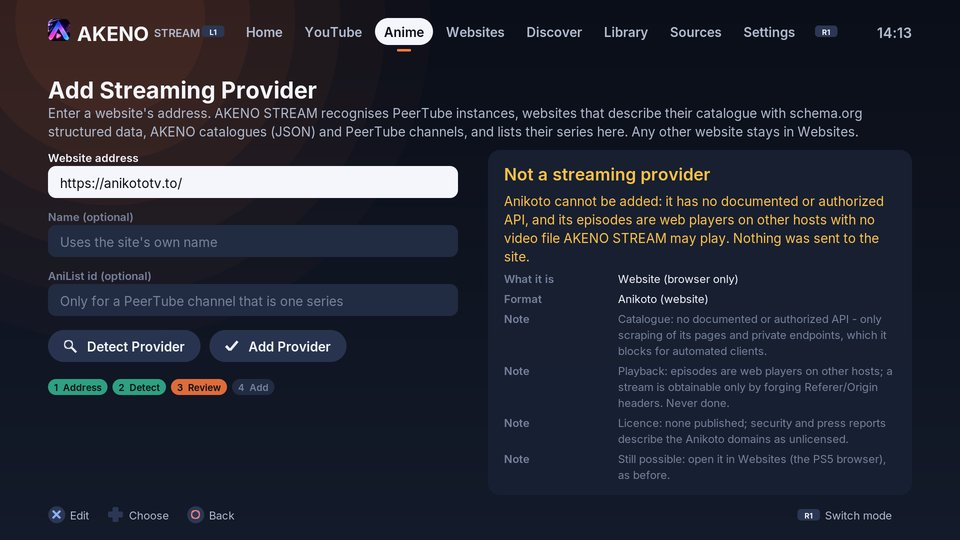

# Anikoto: compatibility report

Can Anikoto (`anikototv.to` and its mirror domains) become a native website
provider in AKENO STREAM - its catalogue, search, series, seasons and
episodes in AKENO's Anime interface, and its episodes in AKENO's native
player? This report records what was investigated (2026-10-11), what the
result is in the app, and why.

**Result: no.** Anikoto offers no documented or authorized way to read its
catalogue, and no authorized, DRM-free video file for any episode. The only
known ways in scrape its pages and private endpoints against its blocking of
automated clients, and turn third-party web players into streams by forging
request headers. AKENO STREAM does neither. *Add Streaming Provider* now says
so precisely, without sending a request to the site, and Anikoto stays in
*Websites*, where the PS5's browser opens it as before.

## What works in AKENO STREAM

| Function | Status | Why |
| --- | --- | --- |
| Open Anikoto in *Websites* (the PS5's system browser) | **Unchanged** | The site's own page in the system browser, as in 1.0. On firmware 12.20 its player loads but playback did not start (earlier console report). |
| Recognised as a provider in *Add Streaming Provider* | **No - explained** | "Anikoto cannot be added: it has no documented or authorized API, and its episodes are web players on other hosts with no video file AKENO STREAM may play. Nothing was sent to the site." Add Provider stays disabled. |
| Native catalogue, search, details | **Not implemented** | No documented or authorized API (below). |
| Seasons and episode lists | **Not implemented** | Same. |
| Native playback in AKENO's player | **Not available** | No authorized direct media resource exists; see *Playback*. Nothing was played or tested on the console because there is nothing permitted to play. |
| *Websites -> Check for native streaming* on an Anikoto address | **Explained** | The same report, also without a request to the site. |
| A provider entry for Anikoto written into the provider file by hand | **Kept, never contacted** | It stays in the file (AKENO never deletes what you saved) and shows the reason instead of loading. |
| Existing providers: AKENO catalogues, PeerTube, website providers, YouTube, the bundled series | **Unchanged** | Covered by the existing tests and by `SitePolicy.CannotBeAddedAndExistingProvidersStayAsTheyWere`. |

## What was investigated

The three projects named in the request, read at these commits (cloned, read,
never run):

| Project | Commit | What it is |
| --- | --- | --- |
| [zainaqdas/anikoto-api](https://github.com/zainaqdas/anikoto-api) | `2fdabe6` (2026-05-18) | "A Node.js API that scrapes anime data (details, episodes, streaming links) from anikototv.to" |
| [Shineii86/AniKotoAPI](https://github.com/Shineii86/AniKotoAPI) | `1d71a1e` (2026-08-27) | "Free REST API scraping anime data from anikototv.to"; "not affiliated with anikototv.to" |
| [hexxt-git/anime-sdk](https://github.com/hexxt-git/anime-sdk) | `72d734f` (2026-06-17) | A multi-site SDK; `src/providers/AnikotoProvider.ts` |

None of them uses an API published or authorized by Anikoto; none cites terms
that allow it. Each is a scraper.

### Catalogue, search, details, seasons, episodes

| Function | How the projects get it |
| --- | --- |
| Home, trending, genres, A-Z | HTML of `https://anikototv.to/home` and category pages, parsed with CSS selectors (cheerio), sent as a desktop Chrome browser (`User-Agent` in `src/configs/header.config.js`; zainaqdas' `scraper/client.js` also sets `Referer` and `Origin` to `https://anikototv.to`). |
| Search | HTML of `/filter?keyword=...` (all three; `AnikotoProvider.searchRaw` selects `.main .item`). |
| Details | HTML of `/watch/<slug>`: the anime id is the `data-id` attribute of `#watch-main`. |
| Seasons | HTML of the watch page: `#ani-seasons .swiper-slide` / `.seasons .item` links to the other seasons' entries (`seasons.extractor.js`). There is no season object; a season is another catalogue entry. |
| Episodes | The private endpoint `/ajax/episode/list/<animeId>` (sent with `X-Requested-With: XMLHttpRequest`), returning an HTML fragment; or the unofficial third-party API `anikotoapi.site` (anime-sdk). The server endpoints below also need session cookies harvested from a watch page (AniKotoAPI `streamInfo.extractor.js`: "AJAX endpoints require session cookies"). |

AniKotoAPI's own documentation (`docs/streaming.md`) states that the site
blocks these endpoints for automated clients: *"Streaming endpoints ... return
errors when anikototv.to blocks AJAX requests from server-side IPs"*, and
recommends ScraperAPI or **FlareSolverr** (a service that solves Cloudflare's
browser challenges) to get past the block. It also rotates mirror domains
(`anikoto.cz`, `.me`, `.net`, `.se`) when one is unreachable. A provider built
on this would scrape pages that are not offered for automated use and depend
on getting around the site's own blocking - which the request excludes and
AKENO does not do.

### Playback

No project finds a video file that Anikoto, or the episodes' rights holders,
publish for playback:

1. `/ajax/server/list?servers=<ids>` and `/ajax/server?get=<linkId>` (private
   endpoints) return an **embed URL**: a web player on another host
   (VidStream, VidCloud, "Kiwi", `megaplay.buzz`, `vidtube.site`).
2. To turn the embed into a stream, AniKotoAPI
   (`src/extractors/streamResolver.extractor.js`) loads the player page,
   extracts hidden attributes (`data-id`, `data-realid`, `data-mediaid`) and
   calls the player host's private `/ajax/sources/<id>` with forged `Referer`
   and `Origin` headers; anime-sdk (`AnikotoProvider.resolveStreamRaw`) reads
   the file id from the player's page title and calls
   `megaplay.buzz/stream/getSources?id=...` with a forged `Referer` and
   `X-Requested-With`.
3. The resulting HLS playlists only answer requests that carry the player
   host's `Referer`. AniKotoAPI says so in `src/helper/streamProxy.helper.js`:
   *"Referer the stream CDNs expect. They answer 403 to the site origin
   (anikototv.to) and to no Referer at all - only the player origin passes"*,
   and adds an M3U8 and segment proxy that forges that `Referer`/`Origin` on
   every request; anime-sdk returns `headers: { Referer:
   'https://megaplay.buzz/' }` with every stream for the player to send.

That is the hosts' hotlink protection, an access restriction, being got
around with forged headers. An embed URL is not an MP4 or HLS file, and the
streams behind it are not offered for third-party players. **There is no
documented, authorized, DRM-free resource to build a playback proof of
concept on**, so none was built: no Play button exists for Anikoto, and none
is claimed. AKENO STREAM's existing native player was therefore not given an
Anikoto session to test, on the host or on firmware 12.20.

### Terms and licensing

- The Anikoto domains could not be reached from the build environment
  (`anikototv.to` did not resolve), so its terms and `robots.txt` could not be
  read; none of the three projects quotes terms that permit automated access.
- The site publishes no licence for the series it shows. Security scanners
  describe the Anikoto domains as unlicensed streaming sites
  ([anikoto.net](https://tools.malwaretips.com/url-scan/anikoto.net),
  [anikoto.com.co](https://tools.malwaretips.com/url-scan/anikoto.com.co),
  [anikoto.dk](https://tools.malwaretips.com/url-scan/anikoto.dk)); some link
  them to HiAnime, which was shut down in 2026 after the arrest of its
  operators ([Piracy Monitor](https://piracymonitor.org/vietnam-seven-arrested/)).
  That link could not be verified for `anikototv.to` itself.

## What AKENO STREAM does instead

`src/anime/site_policy.cpp` recognises Anikoto by its name in any of its
domains (`anikoto`, `anikototv`, `anikotoapi` as a domain label: `anikototv.to`,
`www.anikototv.to`, `anikoto.tv`, `anikoto.net`, `anikoto.com.im`,
`anikoto.cz`, `anikototv.se`, `anikotoapi.site` ...; not `anikotofans.example`
or an address that merely mentions it in its path or query) and:

- `check_source` (*Add Streaming Provider*, *Websites -> Check for native
  streaming*) returns the reasons above without a request to the site;
- `Registry::add` refuses it, whatever type it is given;
- `Registry::load_provider` and the website loaders (`load_website_page`,
  `load_website_series`, `search_website`) refuse an entry for it, so a
  hand-written entry is kept in the file but never contacted.

Tests: `tests/unit/test_site_policy.cpp` (the domains, zero requests while
detecting, adding refused with every other provider file byte for byte
unchanged, a hand-written entry never contacted) and
`ProviderEndToEnd.AnikotoIsExplainedNotAddedAndNeverContacted` (typed on the
controller: detection explains, Add does nothing, no file written, no request
to any Anikoto domain).

## What a native Anikoto provider would need

1. An API documented by the site's operator, with terms that allow a
   third-party app to read the catalogue - not scraping around its blocking.
2. For playback, video files the rights holders authorize for this use,
   offered as plain HTTPS MP4 or HLS without DRM or header checks. Then the
   website-provider adapter interface ([WEBSITE_PROVIDERS.md](WEBSITE_PROVIDERS.md))
   and AKENO's native player already cover the rest, and the console run on
   firmware 12.20 would be the acceptance test.

Neither exists today. Licensed anime with DRM (Crunchyroll and similar) is a
separate question: [CRUNCHYROLL.md](CRUNCHYROLL.md).
