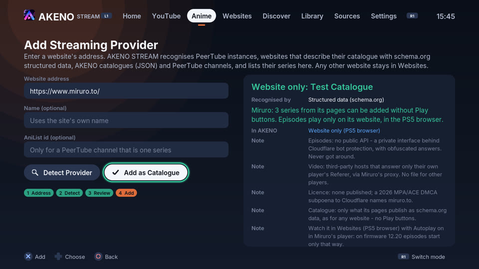
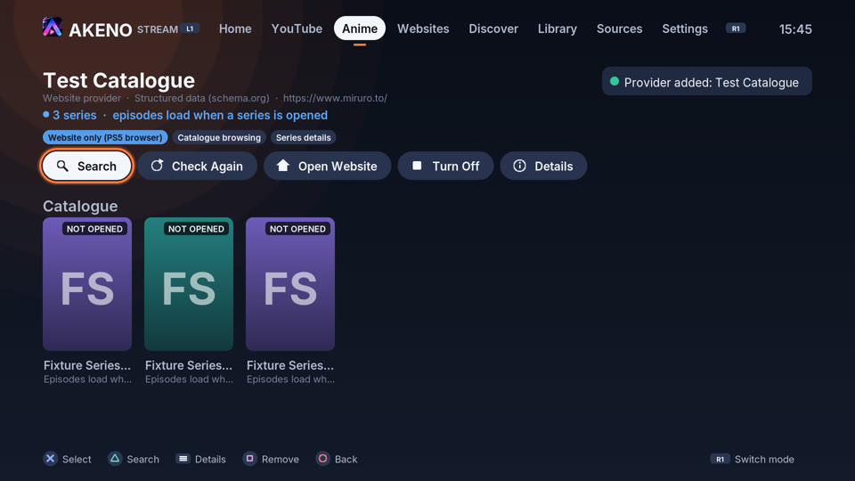
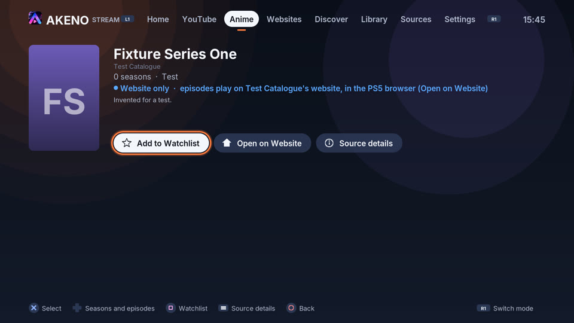

# Miruro: playback investigation and integration report

Miruro (`miruro.to`, `.tv`, `.bz`, `.ru`; `miruro.com` lists them) plays in
AKENO STREAM's browser on a PS5 with firmware 12.20, but only with Autoplay on
in Miruro's own player. What makes the difference, what Miruro is built on,
and what AKENO STREAM can and cannot integrate natively: investigated
2026-10-11, for the 1.1.0 test build after rc.1 (branch `claude/miruro-investigation`).

**Result in short**

| Question | Answer |
| --- | --- |
| Episodes in AKENO STREAM's own player | **No.** Miruro's episodes and streams come through a private interface behind Cloudflare's bot protection, with obfuscated answers, from third-party hosts that check the Referer. There is no file AKENO STREAM may play, and no authorization. Precise categories below. |
| Miruro's catalogue in AKENO STREAM | **Yes, as a catalogue.** The schema.org data its pages publish (the same data 1.1.0-rc.1 found: 49 series) can be added from *Add Streaming Provider*. The provider is labelled **Website only (PS5 browser)** (rc.2: **Browser only (PS5 browser)**): series and details, **no Play buttons**. *Open on Website* opens a series' own page in the PS5 browser. |
| Why Autoplay matters | **Not determined yet.** Confirmed: the browser plays Miruro's video once it has started, so decoding, sound, seeking and the streaming player all work. Only *starting* it differs. Four hypotheses; the Playback Lab's new *Test a Play button* decides between them on the console. |
| Watching Miruro | Unchanged: Websites (the PS5 browser) with Autoplay on in Miruro's player. AKENO STREAM now says so when it opens a Miruro page. This is browser playback, not AKENO STREAM's player. |

## 1. Confirmed on the console

Reported by the tester on a PS5, firmware 12.20, AKENO STREAM 1.1.0-rc.1,
Miruro opened in AKENO STREAM's browser:

| Test | Result |
| --- | --- |
| A. Miruro's Autoplay **off**, episode chosen | The episode does not start |
| B. Autoplay **on**, episode chosen | It starts |
| C. Other series and other episodes, Autoplay on | They start |
| D. Pause, resume, seeking, sound | Work |
| E. AKENO STREAM closed and started again | Autoplay is still on |
| 1.1.0-rc.1 *Add Streaming Provider* on Miruro | Recognised by the schema.org adapter: 49 series, 0 seasons, 0 episodes; "metadata only", could not be added |

## 2. What follows from it

These are deductions from the confirmed results, not separate measurements:

- **The media pipeline is not the problem.** With Autoplay on, Miruro's video
  plays with sound and can be paused, resumed and seeked across series. So the
  PS5 browser decodes the codec Miruro's sources use, and the streaming player
  (MediaSource / HLS) works. Codecs, MSE and HLS are ruled out as the cause of
  test A.
- **Only the start differs.** With Autoplay on, Miruro's player starts the
  video itself. With it off, it waits for a press on its own Play control, and
  that press does not lead to playback.
- **The setting lives in the browser, not in AKENO STREAM.** AKENO STREAM's
  browser is the PS5 system browser (`libSceWebBrowserDialog`), drawn over the
  app. It keeps each site's storage and cookies across sessions; AKENO STREAM
  never sees them and stores nothing for Miruro. Test E shows the system
  browser keeps Miruro's setting. Whether Miruro keeps it in local storage or a
  cookie is not determined: AKENO STREAM cannot look inside the page.

## 3. Why Autoplay off does not start: hypotheses

None of these is confirmed. Miruro's player code is not public (the
`Miruro-no-kuon/Miruro` repository could not be retrieved), and the player
library and how its Play control is wired are unknown.

| | Hypothesis | Would explain A and B because | Decided by (Playback Lab) |
| --- | --- | --- | --- |
| H1 | The controller press never reaches Miruro's Play control as the event it waits for: the press arrives as keys only (no `click`), or the control cannot be reached with the D-pad or cursor | With Autoplay on, no press is needed | `start.press_events`, `start.press_sync` |
| H2 | The press counts, but the player first loads its stream (through its private interface) and calls `play()` afterwards. WebKit lets a press start sound for only about a second (transient user activation), so the late `play()` is refused (`NotAllowedError`) | Autoplay calls `play()` in a way the browser allows | `start.press_after_load`, `start.press_delayed` |
| H3 | The player runs inside a frame from another site, where the press does not count | Same as H2 | `start.press_frame` |
| H4 | The PS5 browser lets pages start video with sound by themselves, which is why Autoplay works | Explains B; needed by every other hypothesis | `playback.autoplay_sound`, `start.autoplay_attribute` |

### The test that decides (new in this build)

Websites -> *Playback Lab* -> *Run the AKENO playback lab*, then
**Test a Play button** (it needs a press, so it is its own button). It uses only
AKENO STREAM's own clip, served from the console itself, and records:

| Result | What it measures |
| --- | --- |
| `start.autoplay_attribute` | A `<video autoplay>` with sound starts without a press (and whether the browser muted it) |
| `start.press_events` | The events one Cross press on a page button sends, in order (for example `keydown(Enter) > keyup(Enter) > click`, or `pointerdown > mousedown > pointerup > mouseup > click`); "no click" when none arrives |
| `start.press_sync` | `play()` with sound inside that press's click handler |
| `start.press_after_load` | `play()` once the page has loaded the file after the press (like a player fetching its stream first) |
| `start.press_delayed` | `play()` 1.5 s after the press |
| `start.press_frame` | A press on a button inside a frame from another origin (`localhost` inside `127.0.0.1`) |

Only a refusal (`NotAllowedError`) or a press without a click counts as "no";
a media error says nothing about the press and counts as "not determined".

Then, in Websites, Miruro's *Video* record has a new answer: **"It starts
only with the site's own Autoplay on"**. Its result, **Starts only by itself
(Autoplay)**, gives the reason from the lab's measurements:

| Lab result | Reason shown |
| --- | --- |
| A press sent no click | Measured: H1 (no click event) |
| A press did not start video | Measured: the browser refuses press-started video here |
| Starts at once, refused after loading or 1.5 s later | Measured: H2 |
| Starts in a page, refused in another site's frame | Measured: H3 |
| Every press test passes | Likely: H1 (Miruro's control does not receive the press). Not a measurement of Miruro itself |
| Not run yet | Not determined, with the instruction to run it |

Settings -> Diagnostics -> Browser, and the exported report, contain every lab
result, the "Starting playback" summary, and each site's record and reason.
Host names only: no paths, cookies, tokens, sign-ins or DRM data.

The lab flow was run in desktop Chromium (Playwright) to check the page code:
every result is produced and the page raises no errors. That says nothing
about the PS5 browser, which is WebKit-based and needs the console run.

## 4. How Miruro is built

Read on 2026-10-11. The projects were cloned and read, never run. `miruro.to`
and `miruro.com` could not be reached from the build environment (its network
policy blocks them), so no Miruro page, terms or `robots.txt` was read
directly. Nothing below was tried against Miruro's servers.

| Source | Commit | What it is |
| --- | --- | --- |
| [Shineii86/MiruroAPI](https://github.com/Shineii86/MiruroAPI) | `78029e3` (2026-08-25) | Unofficial REST API; "not affiliated with Miruro" |
| [walterwhite-69/Miruro-API](https://github.com/walterwhite-69/Miruro-API) | `dfb38a6` | Unofficial API, "v3.0 - curl_cffi bypass" |
| [Miruro-no-kuon/Miruro](https://github.com/Miruro-no-kuon/Miruro) | - | Could not be retrieved. Search results describe an earlier open-source React + Vite front end using the Consumet API; not verifiable |

| Part | How it works |
| --- | --- |
| Catalogue and details | AniList's public GraphQL API (`graphql.anilist.co`): search, details, relations, schedules. Both projects take all metadata from AniList, not from Miruro. AKENO STREAM already uses AniList for its own catalogue. |
| Episodes and streams | A private endpoint, `/api/secure/pipe?e=<request>` on `miruro.{to,tv,bz,ru}`. The request is base64url JSON; the answer is base64url + gzip, XOR-obfuscated with a key from the site's script when the response carries `x-obfuscated: 2` (`PIPE_OBF_KEY` in MiruroAPI's `src/helpers/pipe.js`). |
| Access control | Cloudflare protects the pipe. MiruroAPI sends forged `Origin`/`Referer`/`sec-fetch-*` headers and, when blocked ("Cloudflare is blocking all streaming requests"), routes through ScraperAPI or FlareSolverr (a browser that solves Cloudflare's challenges). Miruro-API impersonates Chrome's TLS fingerprint (`curl_cffi`, `impersonate="chrome110"`) "to bypass Cloudflare's bot detection". |
| Sources | Third-party sources, named `kiwi` (animepahe, via `kwik`), `zoro`, `arc`, `hop` and more. Each stream comes with a `referer` (for example `https://kwik.cx/e/...`) that its CDN requires, and through a proxy (`pru.ultracloud.cc`) whose URLs are XOR-encoded (`PRU_PROXY_KEY` in `api/proxy.js`). |
| "Direct embed" | `megavid.buzz` and `anixo.buzz` iframe URLs: web players on other hosts, not video files. |
| Rights | Miruro publishes no licence for the series. In 2026 the MPA, for ACE, named `miruro.to` among 49 domains in a DMCA subpoena to Cloudflare ([TorrentFreak](https://torrentfreak.com/ace-targets-dozens-of-streaming-pirates-through-cloudflare-and-discord-subpoenas/)). |

There is no official Miruro API: none is documented by Miruro, and both API
projects are unofficial and reverse-engineered.

## 5. Native playback: why not

AKENO STREAM's player could play the format: HLS with H.264 and AAC plays
natively on firmware 12.20 (PeerTube, *Play a Video Link*). Format is not the
blocker. These are:

| Category | Blocker |
| --- | --- |
| Protected interface | Episode lists and streams exist only behind Cloudflare's bot protection, with obfuscated answers. Reaching them means getting around Cloudflare (TLS impersonation, challenge solvers) and decoding with a key taken from the site's script. AKENO STREAM does neither. |
| Access restriction on the media | The streams answer only requests that carry the source host's Referer, and come through an encoded proxy. Forging those headers is getting around hotlink protection. Not done. |
| No authorization | No documented API, no terms permitting third-party playback, no licence for the series; a rights-holder subpoena names the domain. |
| Not a video file | The "embed" sources are web pages with players (`embedUrl`, iframes), not MP4 or HLS files. AKENO STREAM never treats them as streams. |

So no native Miruro playback was built, and none is claimed. No Miruro episode
was played in AKENO STREAM's player, on the host or on the console. An
open-media demonstration of the same path (a schema.org site whose episodes
name real DRM-free files, played in AKENO STREAM's native player) already
exists and is labelled as such: `ProviderEndToEnd.AddBrowsePlaySearchMoreDuplicateRestartRemove`
with `tests/fixtures/website-schema`. It tests the architecture, not Miruro.

## 6. What AKENO STREAM does now

The screenshots use a made-up offline catalogue at Miruro's address (three
invented series), not Miruro's data.

| Where | Behaviour |
| --- | --- |
| *Add Streaming Provider* with a Miruro address | The schema.org adapter reads the homepage and up to six series pages, as a browser would. The report reads "Website only: <name>", with Miruro's four reasons, the Autoplay hint and this document. The button is **Add as Catalogue**. |
| The provider | Saved in `anime-website-providers.json` with `"catalogue": {"playback": "browser-only"}`. Its card and home show **Website only (PS5 browser)**. |
| Its series | Details from Miruro's published data. "Website only - episodes play on Miruro's website, in the PS5 browser (Open on Website)". No Play action and no "Play" hint. **Open on Website** opens that series' page (the URL Miruro's own data names; no episode URL is made up). |
| Opening a Miruro page anywhere (Websites, Open on Website) | While the browser opens: "Watch it in Websites (PS5 browser) with Autoplay on in Miruro's player: on firmware 12.20 episodes start only that way." |
| *Check Again* on a website provider | Runs the whole check again (catalogue, series, videos) and updates the label. |
| Requests | Only Miruro's public pages: never `/api/`, the pipe, a stream, a proxy or another host (checked in the tests). |
| Look-alike domains (`miruro.cx`...) | Not treated as Miruro: they get the generic website check. |

Code: `src/anime/site_policy.cpp` (`known_site()`), `src/anime/registry.cpp`
(`apply_known_site()`, `check_source()`, `Registry::playback_of()`),
`src/anime/provider.cpp` (`classify_playback()`),
`src/app/screen_anime.cpp`, `src/app/screen_browser.cpp`;
the lab: `src/web/pages.cpp`, `src/web/playback_check.cpp`.

Tests: `KnownSite.*` and `PlaybackClass.*` (`tests/unit/test_site_policy.cpp`),
`ProviderEndToEnd.MiruroIsAddedAsACatalogueAndItsSeriesOpenOnTheWebsite`,
`PlaybackStart.*` (`tests/unit/test_playback_check.cpp`),
`LocalPages.PagesCarryASecurityPolicy`. The Miruro tests use a made-up
catalogue served offline at Miruro's address (`tests/host/catalogue_site.cpp`):
invented titles, none of Miruro's data.

## 7. PS5MC

[VivaLaVent/PS5MC](https://github.com/VivaLaVent/PS5MC) at `be3cc85`
(2026-10-05) is Kodi's source tree (its latest commit merges an upstream Kodi
pull request), with no PS5-specific code at that commit. It offers nothing
AKENO STREAM lacks for this problem: its HLS and decoding go through FFmpeg,
which AKENO STREAM already uses (8.0.1), and Kodi add-ons for sites like this
one scrape the same protected interfaces. Nothing was taken from it; AKENO
STREAM neither needs nor launches Kodi.

## 8. What would change the answer

- Miruro, or the rights holders, offering a documented API and DRM-free video
  files licensed for third-party players. Then the website-provider adapter
  interface ([WEBSITE_PROVIDERS.md](WEBSITE_PROVIDERS.md)) and AKENO STREAM's
  native player cover the rest, and a console run on firmware 12.20 would be
  the acceptance test.
- For starting playback in the browser: the console result of *Test a Play
  button* (section 3) names the cause. If it is H1, a press that reaches the
  page as keys only, the PS5 browser's cursor may still reach Miruro's control
  where the D-pad does not.
